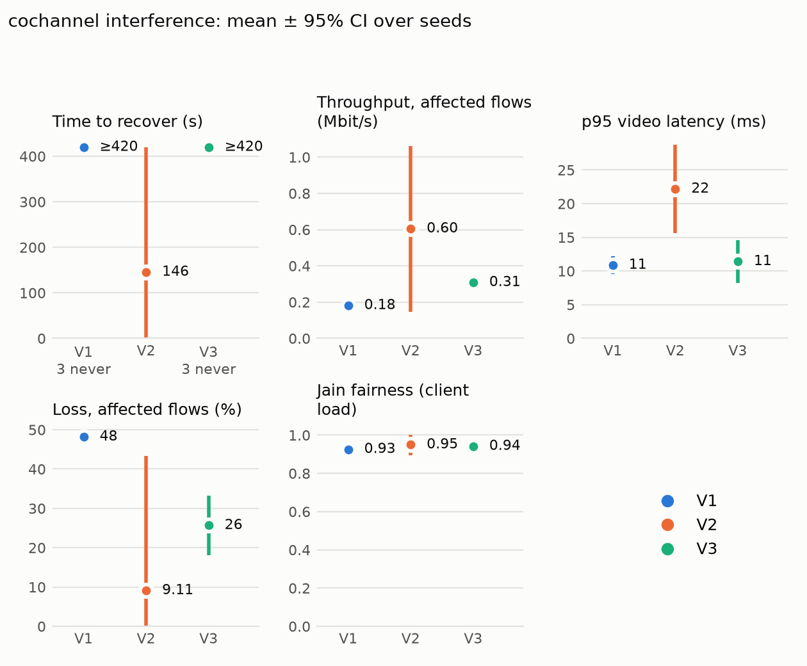

# 6. Evaluation and Results

<!-- P7.1d. Drafted 2026-10-12: 6.1, 6.3 (twin accuracy), 6.4, 6.5 from finished tasks; 6.2 and the H2 part of 6.3 written 2026-10-12 from `make results` only (experiments/results/results.md). Sources: models/twin/v1/validation.json, models/forecast/v1/metrics.json, models/anomaly/v1/metrics.json, models/genai/v1/live.json and rca_replay.json, docs/PHASE_PLAN.md task notes, docs/decisions.md. -->

This chapter tests the three hypotheses of Section 1 against measurements. Every number comes from a script run on recorded data (`make results`, and the evaluation scripts named in each section); none is copied by hand.

## 6.1 Setup: variants, scenarios, seeds

**Variants.** The same testbed runs under three controllers:

| Variant | What acts on the network |
|---|---|
| **V1** plain SDN | Nothing but the controller's L2 learning; stations re-associate by themselves |
| **V2** heuristics without the twin | The heuristic optimiser's proposals are applied directly. The twin's verdict is still computed and recorded, but ignored (evaluation runs only, ADR-005) |
| **V3** full system | Proposals are verified in the twin; only accepted ones are applied, high-impact ones only after an operator's approval, and every change is watched and rolled back on a regression |

**Scenarios.** Three 10-minute scenarios on the 4-AP, 20-station campus (`docs/scenario.md`), each with one disruption:

| Scenario | Disruption (scenario time) | Event AP |
|---|---|---|
| `lecture_flash_crowd` | 10 students walk into the lecture hall from 120 s; video starts at 210 s | (the busiest AP) |
| `ap_failure` | ap2 goes down at 240 s | ap2 |
| `cochannel_interference` | ap3 is forced onto channel 1 at 180 s | ap3 |

**Seeds and runs.** Every variant runs every scenario with seeds 42, 43 and 44: 27 runs in all, at one frozen code version (`eval-v1`, decision P6.4-A). A run that fails is re-run, and the failed attempt is kept and logged.

**KPIs** (problem statement §5.1, defined in decision P6.6-A). Each is computed per run over the *stress window*, from the disruption to the run's end:

- **Time to recover**: seconds from the disruption until the affected AP is under 80% utilisation *and* video p95 latency is at most 50 ms, both holding for 15 s (P4.5-A). A run that never recovers is counted at its run end.
- **Throughput** and **loss**: means over the *affected flows*. These are the flows of the stations on the event's AP in the 30 s before the event, or, in the flash crowd, of the stations on the busiest AP in the 30 s after the onset. They stay affected if they are steered away.
- **Latency**: p95 of the affected video flows.
- **Fairness**: Jain's index of the APs' client counts, per 5 s, averaged over the window.

**Statistics.** Each KPI is reported as the mean over the three seeds with a 95% confidence interval, $\bar x \pm t_{0.975,\,n-1}\, s/\sqrt n$. With $n = 3$ the interval is wide ($t = 4.30$), so differences are claimed only where the intervals do not overlap. A run that never recovers makes its variant's mean time to recover a lower bound. H1 is therefore reported as *met*, *not met* or *inconclusive*, the last where such runs could change the answer.

## 6.2 Recovery and network KPIs (H1)

<!-- From experiments/results/results.md and results.json (make results, 2026-10-12, datasets evalv1-v1, evalv2-v1, evalv3-v1, code eval-v1 = db2ff35). Figures 6.1-6.3 are copies of experiments/results/figures/kpis_<scenario>.png; copy them again after re-running make results. Per-run values and action statuses: results.json "runs" and the read-only executor ledgers data/raw/evalvN-v1/<run>/actions.db. -->

All 27 runs of the campaign passed at the first attempt; none was re-run. Tables 6.1 to 6.3 give each KPI as the mean ± 95% interval over the three seeds. "≥" marks a mean that includes runs which never recovered (counted at the run end), with their number.

**Table 6.1: Lecture flash crowd**

| KPI | V1 plain SDN | V2 heuristics, no twin | V3 full system |
|------------------------------|-----------------------|-----------------------|-----------------------|
| Time to recover (s) | ≥ 390 (3 of 3 never) | ≥ 374 ± 67 (2 never) | ≥ 359 ± 101 (1 never) |
| Throughput, affected flows (Mbit/s) | 0.20 ± 0.00 | 0.52 ± 0.03 | 0.53 ± 0.08 |
| p95 video latency (ms) | 21 ± 1 | 24 ± 8 | 25 ± 9 |
| Loss, affected flows (%) | 43.9 ± 0.3 | 9.2 ± 4.9 | 8.6 ± 2.3 |
| Jain fairness | 0.51 ± 0.00 | 0.78 ± 0.00 | 0.79 ± 0.04 |

**The flash crowd.** Without control (V1), the ten students who walk into the lecture hall all stay on ap1. The affected flows lose 44% of their packets and carry 0.20 Mbit/s each, and the AP never comes back under 80% utilisation. Both controlled variants steer clients to the neighbouring APs: throughput rises to 0.52–0.53 Mbit/s and loss falls to 9%, with intervals far from V1's. Fairness rises from 0.51 to 0.78–0.79, just under the 0.8 target, which is **not met**. One V3 seed reached 0.80. Latency stays low in every variant (21–25 ms), so in this scenario congestion shows as loss, not delay. V3 recovered in 2 of 3 seeds (313 s and 375 s), V2 in 1 (343 s) and V1 in none. V2 and V3 are not distinguishable here: client steering is applied without an operator in both, and the twin rejected only one steer in the three V3 runs.

**Table 6.2: AP failure (ap2 goes down)**

| KPI | V1 plain SDN | V2 heuristics, no twin | V3 full system |
|------------------------------|-----------------------|-----------------------|-----------------------|
| Time to recover (s) | ≥ 360 (3 of 3 never) | ≥ 142 ± 470 (1 never) | ≥ 300 ± 258 (2 never) |
| Throughput, affected flows (Mbit/s) | 0.64 ± 0.09 | 0.84 ± 0.44 | 0.58 ± 0.20 |
| p95 video latency (ms) | 18 ± 0 | 348 ± 1402 | 672 ± 1413 |
| Loss, affected flows (%) | 4.8 ± 1.0 | 10.0 ± 32.5 | 18.8 ± 31.4 |
| Jain fairness | 0.96 ± 0.00 | 0.91 ± 0.06 | 0.89 ± 0.04 |

**The AP failure.** When ap2 goes down, its stations re-associate to ap1 by themselves. Recovery is measured on ap1, the AP the load moves to (Section 6.1). Under V1 the moved flows keep working well (4.8% loss, 18 ms), but ap1 stays above 80% utilisation, so V1 never counts as recovered. V2 recovered in 2 of 3 seeds (17 s and 50 s), V3 in 1 (180 s). The averages hide one failure mode, visible per run, and it is the loop's own (Section 7.1). In one V2 seed and two V3 seeds, the loop steered station sta8 off the overloaded ap2 to ap4, 4–25 s *before* ap2 failed. The steer itself worked. But its 30 s watch then measured the AP failure (loss up, latency up) and blamed the steer, and the executor rolled it back. The rollback tried to move sta8 back to ap2, which was now down. The testbed's steer first disconnects the station and then joins the target AP; joining a disabled AP fails, so sta8 was left with **no AP for the rest of the run** (`rollback_failed`), losing 93–98% of its packets. That one station, among the four affected flows, accounts for the 25–26% mean loss and the p95 latency pinned at the 1 s probe timeout. These three runs alone make the intervals of V2 and V3 span almost the whole scale. In the seeds without that failure, V2 carried more than V1 (0.92–0.96 Mbit/s against 0.62–0.68), and V3 about the same (0.67). In this scenario, doing nothing protected the video better than the loop did, because of a failed rollback, not a bad steer.

**Table 6.3: Co-channel interference (ap3 forced onto channel 1)**

| KPI | V1 plain SDN | V2 heuristics, no twin | V3 full system |
|------------------------------|-----------------------|-----------------------|-----------------------|
| Time to recover (s) | ≥ 420 (3 of 3 never) | 146 ± 445 (all recovered) | ≥ 420 (3 of 3 never) |
| Throughput, affected flows (Mbit/s) | 0.18 ± 0.00 | 0.60 ± 0.46 | 0.31 ± 0.03 |
| p95 video latency (ms) | 11 ± 1 | 22 ± 7 | 11 ± 3 |
| Loss, affected flows (%) | 48.2 ± 0.4 | 9.1 ± 34.2 | 25.7 ± 7.5 |
| Jain fairness | 0.93 ± 0.00 | 0.95 ± 0.05 | 0.94 ± 0.00 |

**The interference.** The fix for a forced channel is to change it back, a **high-impact** action that by design always waits for an operator's approval (Section 4.6). The campaign runs unattended, with no operator. In every V3 run the heuristics proposed the channel change and the twin accepted it, but it was never approved, so it was never applied. V3 could only steer clients away from ap3, which halved the loss (48% → 26%) and raised throughput from 0.18 to 0.31 Mbit/s, without recovering. V2 applies every proposal directly, the channel change included, and recovered in all three seeds (33 s, 52 s and 352 s).

**H1: V3 recovers at least 30% faster than V1.** The verdict is **inconclusive in all three scenarios** (Table 6.4).

**Table 6.4: H1, time to recover of V3 against V1**

| Scenario | V1 | V3 | V3 faster by | Never recovered (V1, V3) |
|------------------------|--------------|--------------|--------------|------------------------|
| Lecture flash crowd | ≥ 390 s | ≥ 359 s | 8% | 3, 1 |
| AP failure | ≥ 360 s | ≥ 300 s | 17% | 3, 2 |
| Co-channel interference | ≥ 420 s | ≥ 420 s | 0% | 3, 3 |

V1 never recovered in any of its nine runs, so every V1 mean is only a lower bound: a longer run could move it, and with it the percentage. The rule of Section 6.1 therefore cannot call H1 met or not met. Read with the per-run results, the evidence is mixed. V3 recovered where V1 did not in 3 of 9 runs. It clearly improved the affected flows in the flash crowd and partly under interference. In the AP failure it made two runs worse than doing nothing. With the operator absent, it could not apply the one action that fixes the interference.

## 6.3 Twin accuracy and blocked actions (H2)

**Prediction accuracy** (P3.5, `models/twin/v1/validation.json`). The twin predicted the per-flow throughput after 586 real situations in the held-out test split: steady state, and actions applied by the executor. Its error is a **mean absolute percentage error of 4.5%**, against a target of under 15%.

| Case (test split) | MAPE | n |
|---|---|---|
| All | 4.5% | 586 |
| Steady state, video | 4.0% | 495 |
| Client steering, video | 3.3% | 39 |
| AP down, video | 1.7% | 8 |
| Channel change, video | 8.1% | 10 |
| Rate limit / tx power / QoS, video | 0.4–0.9% | 3 each |
| Bulk flows (all cases) | 12–21% | 1–20 |

Bulk transfers are predicted least well. Their sending rate depends on TCP's reaction to loss, which the analytical model only approximates, and there are few bulk cases in the data. Video, the traffic the objectives are about, is predicted within 4.5% in every case but the channel change. One simulation takes **0.09 ms** for 60 flows, far under the 1 s budget. The twin stays within **1.04 s** of the network (P3.1: 98.7% agreement with the AP agent over 32 refreshes), against a target of under 3 s.

**Blocked actions (H2).** The executor's ledgers of the 27 runs record every proposal, its twin verdict and what happened to it (read-only, decision P6.5-A). An action counts as *harmful* when the executor's watch measured a regression of more than 10% and rolled it back, or failed to.

**Table 6.5: Actions per variant, from the executor ledgers (9 runs each)**

| | V1 | V2 heuristics, no twin | V3 full system |
|----------------------------------------------|----------------|------------------------|------------------------|
| Proposals recorded | 0 | 64 | 65 |
| Applied | 0 | 64 | 53 |
| Rejected by the twin, and so not applied | – | – | 4 |
| Applied although the twin had rejected them | 0 | 3 | 0 |
| … of which harmful (rolled back) | 0 | 2 (3.1% of applied) | 0 |
| Accepted by the twin, applied, then rolled back | 0 | 20 | 18 |
| Rollback failed | 0 | 1 | 2 |
| High-impact changes applied without an operator | 0 | 9 | 0 |
| High-impact changes accepted, waiting for an operator | – | – | 8 |
| Still watched when the run ended | 0 | 3 | 0 |

V1 proposes nothing. All of V2's and V3's actions are client steers or channel changes.

**What the twin blocked.** The twin rejected 3 of the actions V2 applied, all of them client steers. Two of the three were then rolled back for a measured regression: in one, the measured throughput fell from 3.0 to 1.3 Mbit/s, and in the other the measured latency rose from 12 to 29 ms. The third was kept. In V3 the twin rejected 4 steers, and none of them reached the network. So the twin does block actions that would have hurt KPIs and that V2 applied: **H2 holds**. But it blocked few. Of the 23 V2 actions that the watch measured as harmful, the twin had flagged 2. Most regressions (20 in V2, 18 in V3) came from actions the twin had *accepted*. In both variants, the main protection against those was the watch-and-rollback step, not the twin.

**Safety.** In V3, every applied action had an accepted verdict, and no high-impact change reached the network without an operator. Its 8 accepted channel changes were waiting for approval when their runs ended (Section 6.2). V2 applied 9 channel changes with no operator: 6 were kept and 3 rolled back. The safety rule V3 kept is the reason it could not repair the interference in an unattended run. **Rollback is not guaranteed, and the watch can blame the wrong cause.** In 3 of the 117 applied actions (V2 one, V3 two, all in the AP failure), the rollback failed and left a station without an AP (Section 6.2). In all three, the regression the watch measured was the scripted AP failure, not the action. Over both variants, 4 of the 43 regressions the executor measured had a scripted disruption inside their watch window. The other 39 did not, so the finding that most measured harm followed actions the twin had accepted stands.

## 6.4 Intent accuracy and LLM safety (H3)

**Intents.** On the 30-intent test set (P5.4, scored as schema-valid and equal scope, objectives and constraints), the main model **gpt-oss:120b-cloud** translated **30 of 30** intents correctly with the current prompt (`intent_v2`). The local fallback **qwen2.5:3b** alone translated **21 of 30** (P5.3), against a target of at least 20. The local model's misses were constraints and dropped priorities. _Both are re-measured at `eval-v1` (`make intent-eval`), with response time per intent._

**No invalid output reaches the network.** Every LLM output is validated against the `Policy` schema before the deterministic compiler sees it. An invalid output is repaired at most twice and is otherwise refused (tested). The compiler can only emit bounded actions, and every action goes to the twin. Nothing the LLM produces is applied without an accepted verdict, and high-impact changes also need an operator.

**Copilot and root-cause explainer** (P5.5, P5.6, `models/genai/v1/live.json`). On live runs (seed 44) the copilot answered **5 of 5** diagnostic questions correctly, with evidence from the live tools. The root-cause explainer diagnosed **3 of 3** live faults, each from the first alert, 5 s after the fault. **All 6** actions the LLM proposed have their twin verdict in the audit log, and none was refused as invalid. On replayed data the explainer scored 9/9, 9/9 and 8/9 over three runs of the same input with the cloud model. The local model alone scored 2/9.

## 6.5 Forecasting and anomaly detection

**Forecasting** (P4.1, `models/forecast/v1/metrics.json`). Holt's linear method was compared with a moving-average baseline on per-AP utilisation, rolling-origin, test split. **Holt does not beat the baseline overall**: RMSE at 1 min 0.129 against 0.117, and at 3 min 0.256 against 0.212. It wins only in the flash crowd at 1 min (0.125 against 0.147), the one gradual ramp. In step-like scenarios (an AP going down, a forced channel) extrapolating the trend overshoots. The loop therefore reacts to measured load, not to the forecast.

**Anomaly detection** (P4.2, `models/anomaly/v1/metrics.json`). An Isolation Forest on 30 s whole-network windows, with its threshold chosen on the validation split, scored **precision 0.950, recall 0.979 and F1 0.964** on the test split, with no alert in the normal run. It flagged the AP failure **5 s** after ap2 went down (69 of 72 alerts name ap2) and the forced channel after 25 s. In the flash crowd its precision is 0.867, because it also alerts while the crowd walks in, before the video onset that starts the labelled stress.
